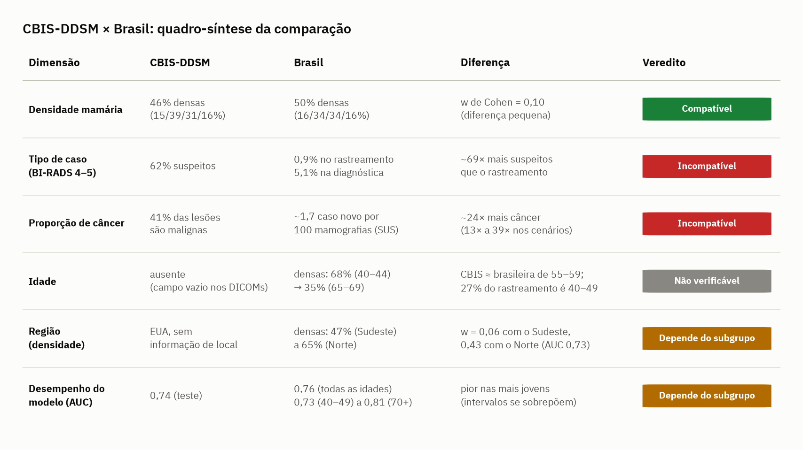

# Representatividade de Bases Públicas de Mamografias no Contexto Epidemiológico Brasileiro

Trabalho da disciplina **Ciência dos Dados** — Engenharia de Computação, CEFET-MG Campus Divinópolis.

**Autores:** Maira Beatriz de Almeida Lacerda · João Francisco Teles da Silva

## Pergunta principal

> Em que medida as características dos casos presentes em uma base pública internacional de mamografias (CBIS-DDSM) são compatíveis com o perfil epidemiológico do câncer de mama no Brasil?

**Questões complementares**

- Como os casos do CBIS-DDSM se distribuem segundo densidade mamária, tipo de anormalidade e classificação BI-RADS?
- Essas características estão associadas à malignidade (benigno × maligno)?

**Hipótese:** existem diferenças entre o perfil representado na base internacional e o contexto brasileiro, o que indica uma limitação de representatividade.

## Resultados

**A hipótese se confirma em parte.** O CBIS-DDSM se parece com o Brasil na média da densidade mamária, mas não no
tipo de caso, e a média esconde os subgrupos (idade, região) em que a diferença é maior.



- **Densidade mamária: compatível no total.** Brasil 16/34/34/16% contra CBIS-DDSM 15/39/31/16% (w de Cohen = 0,10).
- **Tipo de caso: incompatível.** 62% dos casos do CBIS-DDSM são BI-RADS 4–5, contra 0,9% no rastreamento do SUS. A
  base tem de 13 a 39 vezes mais câncer do que os exames do SUS, conforme a definição usada. Com isso, o VPP de um
  modelo cai de 49% na base para cerca de 2,5% no SUS.
- **Idade: ausente na base.** No Brasil, a densidade cai com a idade, e a densidade piora o desempenho do modelo
  (AUC 0,85 em mamas pouco densas, 0,52 nas mais densas). O desempenho estimado é pior nas mulheres de 40 a 49 anos,
  que fazem 27% do rastreamento do SUS.
- **Região: depende.** O CBIS-DDSM se parece com o Sudeste (47% de mamas densas; w = 0,06), mas não com o Norte
  (65%, e 63% mesmo descontando a idade; w = 0,43). O Norte também tem a menor cobertura de rastreamento e a maior
  razão entre óbitos e casos: a população mais vulnerável é a menos representada pela base.
- Os dados brasileiros (SISCAN) são estáveis de 2018 a 2022, inclusive em 2020, quando a pandemia derrubou o número
  de exames em cerca de 40%.

Os detalhes estão nos notebooks e no painel interativo
([`dashboards/painel.html`](dashboards/painel.html), que abre direto no navegador).

## Bases de dados

| Fonte | Conteúdo | Forma de obtenção |
|---|---|---|
| **CBIS-DDSM** ([Kaggle](https://www.kaggle.com/datasets/awsaf49/cbis-ddsm-breast-cancer-image-dataset), versão em JPEG do [TCIA](https://www.cancerimagingarchive.net/collection/cbis-ddsm/)) | Imagens + metadados clínicos: densidade mamária, tipo de anormalidade, tipo/distribuição de calcificação, BI-RADS, patologia | Download direto (CSV + JPEG) |
| **INCA** | Estimativas de incidência, mortalidade, mamografias no SUS 2018–2022 | Web scraping (requests + BeautifulSoup) |
| **DATASUS / TABNET** | Mamografias realizadas (SIA) e óbitos por câncer de mama (SIM), por UF, faixa etária e ano | Web scraping com envio de formulário (requests.post) |
| **DATASUS / SISCAN** | Laudos de mamografia: BI-RADS e densidade (tipo de mama), por UF, faixa etária, indicação e ano | Web scraping de formulário TabnetBD; dados extraídos do JavaScript da resposta |

**Período (dados brasileiros):** mamografias realizadas entre **2018 e 2022**, além das estimativas de incidência mais recentes. O CBIS-DDSM é tratado como base **transversal**.

**Limitação conhecida:** o CBIS-DDSM não traz a idade individual das pacientes, o que restringe comparações diretas por faixa etária.

## Notebooks

| Notebook | Conteúdo |
|---|---|
| [`01_analise_exploratoria`](notebooks/01_analise_exploratoria.ipynb) | Brasil (mamografias, mortalidade, incidência, regiões, pandemia); perfil do CBIS-DDSM e associação com malignidade; proporção de câncer nas duas bases e teste de robustez |
| [`02_imagens_calcificacoes`](notebooks/02_imagens_calcificacoes.ipynb) | Qualidade das imagens; processamento de microcalcificações; modelo simples e seu desempenho por densidade, prevalência e região |
| [`03_comparacao_birads_densidade`](notebooks/03_comparacao_birads_densidade.ipynb) | Comparação direta com o SISCAN: densidade (geral, por idade e por região), BI-RADS, estabilidade 2018–2022 e AUC reponderada pela composição brasileira |
| [`04_quadro_sintese`](notebooks/04_quadro_sintese.ipynb) | Quadro-síntese e resposta à pergunta |

Detalhes e dependências em [`notebooks/README.md`](notebooks/README.md).

## Estrutura do repositório

```
.
├── data/
│   ├── raw/            # dados brutos (não versionados)
│   │   ├── inca/
│   │   ├── datasus/
│   │   └── cbis-ddsm/  # CSVs de metadados + jpeg/ (link para as imagens)
│   ├── interim/        # dados extraídos pelos scrapers (CSV)
│   └── processed/      # resultados dos notebooks usados por outros notebooks e pelo painel
├── notebooks/          # análises, numeradas na ordem de execução
├── src/
│   ├── config.py       # caminhos e URLs centralizados
│   ├── scraping/       # coleta INCA, TABNET (SIA/SIM) e SISCAN
│   ├── processing/     # leitura e padronização do CBIS-DDSM
│   ├── analysis/       # testes estatísticos
│   ├── images/         # PDI e extração de características (OpenCV/scikit-image)
│   └── visualization/  # estilo dos gráficos e geração do painel
├── reports/figures/    # figuras geradas pelos notebooks
├── dashboards/         # painel interativo (painel.html) e seus dados
├── docs/               # pré-projeto, proposta e documentação da coleta
├── tests/
└── rodar_tudo.sh       # refaz tudo na ordem certa
```

## Como rodar

```bash
python3 -m venv .venv
source .venv/bin/activate
pip install -r requirements.txt
```

Com o ambiente pronto e o CBIS-DDSM no lugar (ver abaixo), um comando refaz o projeto inteiro: coleta, notebooks
(01 → 02 → 03 → dados do painel → 04), painel e testes.

```bash
./rodar_tudo.sh               # coleta só o que ainda não foi baixado
./rodar_tudo.sh --sem-coleta  # não acessa a internet; usa o HTML já salvo em data/raw/
```

### Coleta (web scraping)

Também dá para rodar cada fonte separadamente:

```bash
python -m src.scraping.inca      # INCA: incidência, mamografias no SUS (2018–2022), mortalidade
python -m src.scraping.tabnet    # TABNET: mamografias (SIA) e óbitos por câncer de mama (SIM), 2018–2022
python -m src.scraping.siscan    # SISCAN: laudos de mamografia por BI-RADS e densidade, 2018–2022
```

HTML bruto em `data/raw/`, CSVs em `data/interim/`. Análise de cada fonte e problemas encontrados:
[docs/scraping_inca.md](docs/scraping_inca.md) · [docs/scraping_tabnet.md](docs/scraping_tabnet.md) ·
[docs/scraping_siscan.md](docs/scraping_siscan.md).

Testes:

```bash
python -m pytest
```

### CBIS-DDSM (Kaggle)

O dataset **não é versionado** no repositório: são ~6 GB (10.237 imagens JPEG), acima do que o GitHub
aceita, e a fonte deve ser citada em vez de redistribuída. Cada pessoa baixa a sua cópia.

**1. Baixar** a versão do Kaggle, [CBIS-DDSM: Breast Cancer Image Dataset](https://www.kaggle.com/datasets/awsaf49/cbis-ddsm-breast-cancer-image-dataset).
Dá para baixar o `.zip` pelo navegador ("Download") ou usar a API do Kaggle. A API exige um token pessoal:
gere em *Kaggle → Settings → API → Create New Token* e salve o arquivo em `~/.kaggle/kaggle.json`.

```bash
pip install kaggle
kaggle datasets download -d awsaf49/cbis-ddsm-breast-cancer-image-dataset -p ~/datasets --unzip
```

**2. Colocar no projeto.** O projeto espera esta estrutura:

```
data/raw/cbis-ddsm/
├── mass_case_description_train_set.csv
├── mass_case_description_test_set.csv
├── calc_case_description_train_set.csv
├── calc_case_description_test_set.csv
├── dicom_info.csv          # 1 linha por imagem; liga imagem ↔ lesão
├── meta.csv
└── jpeg/                   # imagens (pasta ou link simbólico)
```

Copie os CSVs da pasta `csv/` do download. Para as imagens, em vez de copiar 6 GB, crie um **link simbólico**
para a pasta `jpeg/` baixada:

```bash
cp ~/datasets/csv/*.csv data/raw/cbis-ddsm/
ln -s ~/datasets/jpeg data/raw/cbis-ddsm/jpeg
```

**3. Conferir:**

```bash
python -c "from src.processing.cbis import carrega_imagens; d = carrega_imagens(); print(d.existe.sum(), 'de', len(d), 'imagens encontradas')"
```

Para abrir os notebooks de forma interativa:

```bash
jupyter lab
```

## Fontes dos dados

- Kaggle – CBIS-DDSM Breast Cancer Image Dataset
- The Cancer Imaging Archive – CBIS-DDSM
- INCA – Fontes de Informação sobre o Controle do Câncer de Mama
- INCA – Controle do câncer de mama no Brasil: dados e números 2024
- DATASUS – Informações de Saúde (TABNET: SIA, SIM e SISCAN)
- ANS – Panorama da Saúde Suplementar (cobertura de planos de saúde, usada em um cenário do teste de robustez)
